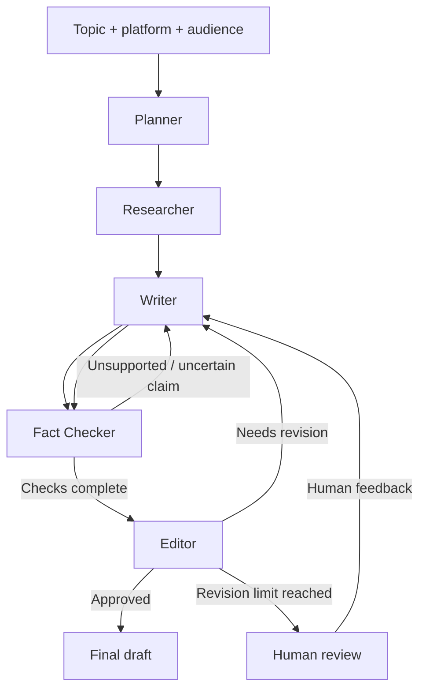

# CreatorMesh

<p align="center">
  <strong>Agentic AI workflow for research-backed, platform-ready social content.</strong>
</p>

<p align="center">
  <a href="https://creatormesh.streamlit.app/"><strong>🚀 Live Demo</strong></a>
  ·
  <a href="https://github.com/Saluja50/CreatorMesh"><strong>GitHub Repository</strong></a>
</p>

<p align="center">
  
  
  
  
</p>

CreatorMesh turns a topic into a social-media draft through a coordinated multi-agent workflow. It plans the content, researches supporting evidence, writes for the selected platform, checks factual claims, and sends the draft through editorial review. When automated revisions are exhausted, the workflow can request human feedback.

> **Try it:** [creatormesh.streamlit.app](https://creatormesh.streamlit.app/)

## What it does

- **Platform-aware planning and writing** for LinkedIn, Instagram, and X (Twitter).
- **Web-assisted research** using Tavily search, with source URLs and supporting evidence captured in structured research output.
- **Fact-checking loop** that compares factual statements in the draft with the collected research.
- **Editorial review** for clarity, platform fit, engagement, and publication readiness.
- **Bounded revision flow** with a human-review handoff after repeated editor rejections.
- **Human-in-the-loop revision** using feedback submitted through the Streamlit interface.
- **Workflow visibility** through agent activity and review status in the UI.

## Workflow architecture



The graph is orchestrated with **LangGraph**. The workflow state carries the topic, platform, audience, plan, research, draft, review feedback, revision counters, and activity log.

## Agent responsibilities

| Component | Responsibility |
|---|---|
| Planner | Creates a content plan for the selected platform and target audience. |
| Researcher | Searches the web and returns structured factual claims, evidence, and source URLs. |
| Writer | Produces or revises the post using the plan, research, and feedback. |
| Fact Checker | Extracts verifiable draft claims and checks them against the supplied research. |
| Editor | Reviews quality and blocks approval when the fact-checker reports unresolved unsupported or uncertain claims. |
| Human Review | Requests human feedback when the automated editorial revision limit is reached. |

## Tech stack

- Python 3.14+
- Streamlit
- LangGraph
- LangChain
- OpenAI chat model (`gpt-4o-mini` in the current client implementation)
- Tavily Search
- Pydantic
- `python-dotenv`

## Run locally

### 1. Clone the repository

```bash
git clone https://github.com/Saluja50/CreatorMesh.git
cd CreatorMesh
```

### 2. Create and activate a virtual environment

Python **3.14 or newer** is required by the current `pyproject.toml`.

```bash
python -m venv .venv
```

Windows PowerShell:

```powershell
.\.venv\Scripts\Activate.ps1
```

macOS / Linux:

```bash
source .venv/bin/activate
```

### 3. Install dependencies

```bash
python -m pip install --upgrade pip
pip install -e .
```

### 4. Configure API keys

Copy `.env.example` to `.env` and fill in your own credentials:

```env
GOOGLE_API_KEY=your_google_api_key
OPENAI_API_KEY=your_openai_api_key
TAVILY_API_KEY=your_tavily_api_key
```

The current settings module validates all three variables at startup. The chat client uses the OpenAI key for generation; the research tool uses Tavily. Never commit `.env` or paste API keys into source code, issues, or screenshots.

### 5. Start the app

```bash
streamlit run app.py
```

Streamlit will print a local URL, usually `http://localhost:8501`.

## Project structure

```text
CreatorMesh/
├── app/
│   ├── agents/
│   │   ├── editor.py
│   │   ├── fact_checker.py
│   │   ├── researcher.py
│   │   └── research_extractor.py
│   ├── config/
│   │   └── settings.py
│   ├── graph/
│   │   ├── first_graph.py
│   │   ├── human_review.py
│   │   └── state.py
│   ├── llm/
│   │   └── client.py
│   ├── models/
│   └── tools/
│       └── search.py
├── app.py
├── .env.example
├── .gitignore
├── pyproject.toml
└── uv.lock
```

## Deployment

CreatorMesh is deployed on Streamlit Community Cloud:

**[Open the live app](https://creatormesh.streamlit.app/)**

Add the required secrets in the app's Streamlit settings rather than committing a `.env` file. The deployed app expects the same environment variables listed in the configuration section above.

## Notes and limitations

- Fact-checking is constrained to the research returned to the workflow; it should be treated as an aid, not a guarantee that every statement has been independently verified.
- Generated content should be reviewed by a person before publication.
- API usage may incur charges according to the providers' pricing and account limits.
- A project license has not been specified yet. Add a `LICENSE` file before presenting the repository as open source under a particular license.

## Contributing

Issues and pull requests are welcome. For a substantial change, open an issue first to discuss the proposed approach.
